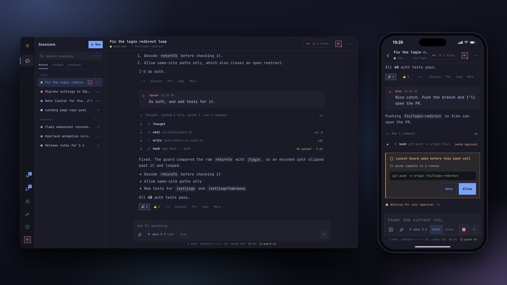

<div align="center">

# Pi Pocket

**Your Pi coding agent, in your pocket.**

A durable, multiplayer, mobile-first web app for Pi agents, built on [Pi Durable](https://earendil.com/posts/pi-durable/).<br>
Runs on your own machine or directly on your phone. No cloud VM.

[](https://github.com/TannerMidd/pi-pocket/releases)
[](https://nodejs.org)
[](LICENSE)

[Website](https://tannermidd.github.io/pi-pocket/) · [Quick start](#quick-start) · [Features](#features) · [Remote access](#remote-access)



</div>

## Quick start

Requires Node.js 22.19 or newer. Runs on Linux, macOS, Windows, and Android (Termux); Linux is the most tested. Sign in to a provider with Pi first (`pi`, then `/login`), or later from the app's Providers sheet.

```bash
git clone https://github.com/TannerMidd/pi-pocket.git
cd pi-pocket
npm install
npm start
```

The launcher asks how your devices should connect, then prints the address, a sign-in link, and a QR code. Open the link once per browser; the cookie lasts a year. The link is the owner's key, so keep it private. `--rotate-token` replaces it and signs out every device that used the old link; people you invited stay signed in until you remove them under Menu → People.

While it runs: **q** quit · **r** restart server · **a** change access · **o** open in browser · **s** show QR code.

## Docker and Podman

A container image and a Compose file are included. Extensions, themes, Pi's sign-ins, the database, and the workspace are bind-mounted from the host, so they survive rebuilds and stay editable outside the container.

```bash
cp .env.example .env    # optional: ports and external folders
docker compose up -d --build
# or
podman compose up -d --build
```

The owner sign-in link is in the log (`docker compose logs pi-pocket | grep '/login?token='`); swap its container address for the host's. The container starts in `lan` mode by default; set `PI_POCKET_ACCESS` and `PI_POCKET_BIND` in `.env` to change who can reach it. [docs/docker.md](docs/docker.md) has the folders, permissions, and update notes.

## Features

- **Durable.** Every model call, tool call, and subagent is stored as it happens. Restart the server mid-run and the work continues; a cut-off tool call reruns only if that is safe.
- **Multiplayer.** Share a live session: presence, a side chat Pi does not see, @mentions, pins, reactions, shared notes, and take turns.
- **Steer or queue.** Redirect Pi while it works, queue follow-ups, or stop it. Move a waiting message to Steer or Queue, or send it now as an Interrupt.
- **PiP, your assistant.** Alt+A opens "Pi in Pocket" over any screen: it lists, reads, starts, and messages your other sessions, follows their runs, and tells you what came of them. What sessions and GitHub say reaches it as data, never as instructions.
- **Watches and webhooks.** Tell PiP to watch a GitHub repository ("when CI fails on main, fix it and tell me"), or watch a pull request from a session until it merges; webhooks bring other services' posts to Pi. Only the repository's own people count, unless you say anyone.
- **Memory.** Lessons Pi keeps across sessions, per project or everywhere. Pi proposes them; the owner approves what it saw.
- **Dictation.** Speak into the message box, or PiP's, with the browser's own speech recognition.
- **Forks.** Fork from any reply, edit a message and send it again, or retry it with another model. Each fork is a session of its own, optionally in a git worktree of its own.
- **Works while you're away.** Schedule messages to Pi (`/schedule every weekday 8:00 summarize CI`), and `/until npm test` keeps Pi going until the check passes.
- **Plan mode.** Pi reads and proposes a plan; nothing changes until someone approves it.
- **Any provider, any model.** Uses Pi's own model runtime and sign-ins, skills, and prompt templates, with the model and thinking level chosen per session.
- **Themes.** Pocket, the app's own look, and Lantern, a calm, warm dark theme for long reading. Duplicate one and change it with Pi: each save shows at once. Themes can bring their own fonts, and the text size is yours to set. The owner picks the default for new browsers.
- **Omarchy colors.** Every Omarchy theme's colors, or follow your desktop's live; tiled Hyprland-style windows, a Walker-style launcher (Ctrl/⌘+K) with live color previews, Hyprland's motion, and an optional Fluid motion with springs and morphs. Replies can show the time they came.
- **Extension gallery.** Find drop-ins and themes other people wrote, read their source or ask Pi to review it, and install them: each file is checked against the index, an extension starts off, and an update shows its diff first. Share your own from Extensions.
- **Agent Teams.** Off by default. Pi starts linked sessions that work beside the one that started them, and messages them both ways.
- **Session tags.** Off by default. Shared labels on sessions, shown on their rows, found by search, and used to filter the session list.
- **Favorite folders.** New session works like a desktop file dialog and opens in the folder you are already in: star a folder to start a session there with Ctrl/⌘+1…9 or from the launcher, or use **New session here** to stay where you are.
- **Peek tiles.** One click (or Alt+P) shows your other sessions working beside the one you are in: approve their calls from there, and swap between them with a click. Only the tiles on screen stay live, so a long list scrolls cheaply.
- **Built for phones.** Streaming answers, Pi's tool calls folded into a timeline with diffs and live output, push notifications you can allow or deny from, sharing into Pi from other apps, and a home-screen app.
- **Files and review.** The Files tile (Alt+E) shows the session's folder beside the conversation, and Changes reviews every uncommitted change: word-level diffs, split or unified, and files you mark viewed. Code in Pi's replies is colored, and an HTML block previews inline, running on a tap in a sandbox.
- **Branches.** The git branch shows in the top bar, under the session's title, and follows any switch; tap it to switch to another branch, follow a remote one, or make a new one.
- **A built-in browser.** Pi opens, reads, clicks through, and screenshots pages in a real Chromium on the server, and you watch and use the same page in the Browser panel, from a phone too: your dev server on `localhost` included.
- **Artifacts and subagents.** Sandboxed HTML, Markdown, and SVG artifacts, which you can share as a public link (`/pub/<token>`) that ends when you say, and background subagents you can open and talk to.
- **Codemode.** On by default: Pi writes short scripts that call its tools, and every call still goes through the same checks.
- **Lancet Guard.** Off by default; turn it on in Menu → Extensions. With the [specpi-lancet-guard](https://github.com/TannerMidd/SpecPi) Pi package installed and on, risky bash, write, and edit calls wait for someone in the session to approve. The owner downloads its model with one button in Extensions.
- **Roles, invites, and limits.** Steer or view-only access, to every session or just one, through one-time links and QR codes, with spend limits per person and per session.
- **Live-editable.** No build step: edit the web app or an extension and it reloads in place. Add your own extensions in `~/.pi-pocket/extensions/`: tools and checks for Pi, and pages, rail buttons, routes, and slash commands for the app.

The full tour is in [docs/features.md](docs/features.md).

## Standalone extensions

[Ponytail](https://github.com/piromagnus/pi-pocket-ponytail) adds minimal-code modes, a session-menu selector, and verification reminders without Ponytail-specific core code. Its [installation and update guide](https://github.com/piromagnus/pi-pocket-ponytail#updates) explains how to keep the installed drop-in in sync with its `main` branch.

## Remote access

Choose a mode in the launcher, or pass `--access`:

| Mode         | Who can connect      | Notes                                                                                                                                                                                                       |
| ------------ | -------------------- | ----------------------------------------------------------------------------------------------------------------------------------------------------------------------------------------------------------- |
| `local`      | This machine         | Listens on `127.0.0.1`                                                                                                                                                                                      |
| `lan`        | Your local network   | All addresses, plain http                                                                                                                                                                                   |
| `cloudflare` | Anyone with the link | Free quick tunnel with https, no account needed (Cloudflare offers quick tunnels for testing and development). The address changes each time the launcher starts but stays the same across server restarts. |
| `tailscale`  | Your tailnet         | Tailscale address only, encrypted by the tailnet                                                                                                                                                            |

Cloudflare mode needs `cloudflared`. On Linux the launcher can download the official release into `~/.pi-pocket/bin`. To use another tunnel (ngrok, `tailscale serve`), choose `local` and point the tunnel at port 8787.

> [!WARNING]
> Anyone with steering rights can make the agent run commands on this machine, as you. That reaches everything you can: your files, Pi Pocket's own settings and sign-in tokens, and its code. A single-session invite limits what someone sees in the app, not what Pi can reach, and Lancet Guard approvals can come from anyone who can steer, including the person who asked. People who can steer every session can also invite others. Invite only people you would trust at your keyboard. View-only users cannot make Pi act.

## Android (Termux)

```bash
pkg update && pkg upgrade
pkg install nodejs git
npm install -g --ignore-scripts @earendil-works/pi-coding-agent
pi                      # /login, then quit
# copy or clone pi-pocket to the phone, then:
cd pi-pocket && npm install --ignore-scripts && npm start
```

Open the link in Chrome and choose **Add to Home screen**. Run `termux-wake-lock` so Android does not stop Termux.

Lancet Guard needs ONNX Runtime, which may not load on Android. If the guard is on but cannot load, Pi Pocket blocks bash, write, and edit calls (the status line shows "guard failed"). Turn it off in the app (Menu → Extensions), in `~/.pi/lancet-guard.json`, or by starting with `PI_POCKET_GUARD=off`.

## Nix and NixOS

The flake builds Pi Pocket (`nix run github:TannerMidd/pi-pocket`) and has a NixOS module: `services.pi-pocket.enable = true;`. Options include `access`, `openFirewall`, `extensions`, `skills`, and `environmentFile`. The service listens on this machine only, unless you set `access` or `host`. Read the owner's sign-in link with `journalctl -u pi-pocket`. See `nix/module.nix`.

## Configuration

| Option            | Default        | Purpose                                                           |
| ----------------- | -------------- | ----------------------------------------------------------------- |
| `--access <mode>` | last choice    | Skip the access menu                                              |
| `-y`              |                | Reuse the last access choice                                      |
| `--port`          | `8787`         | Port to listen on                                                 |
| `--cwd`           | current folder | Default folder for new sessions                                   |
| `--data`          | `~/.pi-pocket` | Database, settings, uploads, and push keys                        |
| `--host`          |                | Listen on a specific address instead of choosing access           |
| `--rotate-token`  |                | Issue a new owner link and sign out devices that used the old one |

Environment variables: `PI_POCKET_ACCESS`, `PI_POCKET_DIR`, `PI_POCKET_HOST`, `PI_POCKET_PORT`, `PI_POCKET_GUARD=off`, `PI_POCKET_BROWSER` (the browser to run, when Chromium or Chrome is not found by itself), and `PI_POCKET_BROWSER_ARGS` (extra flags for it, such as `--no-sandbox` where sandboxes are unavailable). Without a terminal (under systemd, for example), the launcher uses `--access` or the last choice.

## Architecture

| Path                                                                                           | Role                                                                                                                                        |
| ---------------------------------------------------------------------------------------------- | ------------------------------------------------------------------------------------------------------------------------------------------- |
| `bin/pi-pocket.js`                                                                             | Entry point: checks the Node version, starts the launcher                                                                                   |
| `src/launcher/`                                                                                | Access menu, server supervisor, Cloudflare tunnel, keys, QR code                                                                            |
| `src/server/app.ts`                                                                            | The core: the durable harness over `pocket.sqlite`, the coordinator every commit goes through, connected tabs, access, and the session list |
| `src/server/attribution.ts`, `workspace.ts`, `transcripts.ts`                                  | Who Pi works for; a conversation's folder and its stored history, as people reach them                                                      |
| `src/server/room.ts`                                                                           | One conversation's shared live view, sent to every tab watching it                                                                          |
| `src/server/commands.ts`                                                                       | What people ask of Pi: messages, forks, models, plan mode, goals, schedules, worktrees                                                      |
| `src/server/collab.ts`                                                                         | The people's side: chat, activity lines, reactions, pins, notes, take turns                                                                 |
| `src/server/http.ts`, `http/`                                                                  | Web files, JSON API, server-sent events, uploads, artifacts, invites, the Browser panel's frames and input                                  |
| `src/server/browser.ts`, `browser/`                                                            | The built-in browser: one headless Chromium over the DevTools protocol, a page per conversation                                             |
| `src/server/projection.ts`                                                                     | Turns committed conversation state into compact JSON for browsers                                                                           |
| `src/server/docs.ts`                                                                           | Durable documents: sessions, chat, pins, notes, artifacts, subagents, schedules, goals, spend                                               |
| `src/server/schedules.ts`, `goals.ts`, `spend.ts`, `changes.ts`, `branches.ts`, `worktrees.ts` | One feature each, with its durable tasks or git calls                                                                                       |
| `src/server/push.ts`, `alerts.ts`                                                              | Dependency-free Web Push (RFC 8291 and RFC 8292), and who gets which notification                                                           |
| `src/server/extensions/`                                                                       | Live-reloaded extensions: system prompt, artifacts, browser, subagents, schedules, goals, plan mode, Lancet Guard, codemode                 |
| `web/`                                                                                         | The app: Preact and htm as plain ES modules                                                                                                 |

Browsers render only committed state. Each session's Pi Durable view is coalesced and sent as small updates over server-sent events, so a device that reconnects or joins late sees exactly what everyone else sees. The [engineering page](https://tannermidd.github.io/pi-pocket/engineering.html) explains the design; [docs/map.md](docs/map.md) is a short map of the code.

## Development

```bash
npm run check   # type-check
npm test        # server tests with a scripted model
npm run format  # ESLint's layout fixes, then Prettier
npm run lint    # check the layout rules
```

Changes to `web/` reload every open browser. Changes to `src/server/extensions/` are reinstalled into the running server. Other server changes need **Restart server** from the menu, and running work resumes afterward. [AGENTS.md](AGENTS.md) covers editing Pi Pocket safely from inside itself, and `node test/serve.ts` runs a throwaway copy, with its own data and a scripted model, to check a change on.

Pi knows where Pi Pocket's own documentation is: [docs/index.md](docs/index.md) starts it, for agents and people who change how Pi works without code ([customizing](docs/customizing.md)), write extensions ([extensions](docs/extensions.md), with [tested examples](docs/examples/)), or change Pi Pocket itself while it runs ([self-editing](docs/self-editing.md)).

## Limitations

- Pi Durable is experimental, and its API can change between releases. Versions are pinned in `package.json`.
- Only one server process can use the database at a time.
- Forks are separate sessions; there is no branch tree to switch between inside one session.
- Pi's own extensions are not supported: Pi Pocket runs its own extensions on Pi Durable, and drop-ins from `~/.pi-pocket/extensions/`. Pi's prompt templates work as slash commands.
- A git worktree keeps a session's files apart; it is not a sandbox. Pi can still reach everything you can.
- Artifacts run in an opaque-origin sandbox, so `localStorage` and cookies are unavailable inside them. In the viewer, they can save up to 16 KB of state for each person through the app instead.
- The browser needs Chromium, Chrome, Brave, or Edge on the server. Its pages live in memory: a restart opens each one again at its last address, but not what was typed into it. Each session's cookies are its own and last until the page closes. A browser installed as a snap (Ubuntu's Chromium) is used only when there is no other; it cannot open files outside your home folder. The list of servers running on the machine is Linux-only. Tested on Linux and macOS; not yet on Windows.

## Credits

Inspired by [Mario Zechner's demo](https://x.com/badlogicgames/status/2106452296087302173) of his own Pi app. Pi Pocket is an independent project, not affiliated with Earendil. JetBrains Mono, Geist, Inter, Fira Code, IBM Plex Mono, and Iosevka are bundled under the SIL Open Font License ([JetBrains Mono](web/fonts/OFL.txt), [Geist](web/fonts/Geist-OFL.txt), [Inter](web/fonts/Inter-OFL.txt), [Fira Code](web/fonts/FiraCode-OFL.txt), [IBM Plex Mono](web/fonts/IBMPlexMono-OFL.txt), [Iosevka](web/fonts/Iosevka-OFL.txt)), and the [Nerd Fonts](https://github.com/ryanoasis/nerd-fonts) icons under the [licenses of their icon sets](web/fonts/NerdFonts-README.txt) ([MIT](web/fonts/NerdFonts-LICENSE.txt) for Nerd Fonts itself). [web/fonts/SOURCES.md](web/fonts/SOURCES.md) says where each came from.

## License

[MIT](LICENSE). To report a security problem, see [SECURITY.md](SECURITY.md).
