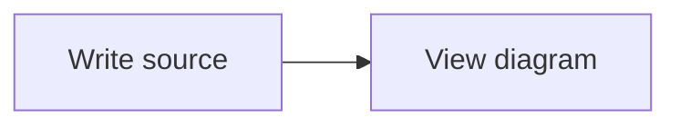

# Mermaid drop-in

Render fenced `mermaid` blocks in chat Markdown. The core keeps the original source in a disclosure below each diagram. Other code blocks stay unchanged.

**Pi Pocket 0.27.0 cannot run this extension.** It needs the experimental `pocket.codeBlock` API from the accompanying PR. Do not enable it on 0.27.0. It reports the missing API rather than changing the chat DOM.

## Build and test

From the repository root:

```sh
npm ci
cd contrib/mermaid
npm ci
npm run build
npm run check
npm test
```

The browser tests need a Chromium-based browser. They start a separate app with temporary data and a scripted model. They do not use your account, your sessions, or a paid model.

The local bundle contains pinned Mermaid 12.2.0 and DOMPurify 3.4.17. It is generated, not committed. `package-lock.json` pins its dependency tree. `mermaid/vendor.js.LEGAL.txt` contains the bundle's license notices. The bundle is about 5 MiB, below the browser module's 8 MB file limit. The app does not allow CDN scripts. No package is added to Pi Pocket's core dependencies.

## Install, without enabling

First use a Pi Pocket version with the new API. Do not replace a running installation from an agent session. The owner must choose when to install it and restart.

After the tests pass, copy the built extension. These commands stop if either destination already exists:

```sh
ext="$HOME/.pi-pocket/extensions"
test ! -e "$ext/mermaid.ts" && test ! -e "$ext/mermaid" || exit 1
cp mermaid.ts "$ext/mermaid.ts"
mkdir "$ext/mermaid"
cp mermaid/index.js mermaid/style.css mermaid/vendor.js \
    mermaid/vendor.js.LEGAL.txt "$ext/mermaid/"
```

Run them from `contrib/mermaid/`. Keep the existing `_pocket.d.ts` and `node_modules` links in the extension folder. No restart is needed to discover a new drop-in. It starts off.

## Owner: review and enable

1. Read `mermaid.ts`, `mermaid/index.js`, and `mermaid/style.css`. Review the pinned dependencies and the generated bundle too.
2. Confirm that your running version has `pocket.codeBlock`. Version 0.27.0 does not have it.
3. Open **Menu → Extensions → Installed**. Find the local **Mermaid** module (`mermaid.ts`). Turn it on.
4. Open a session with this Markdown:

````markdown

````

5. Check the diagram and open its source disclosure. Try an invalid diagram to check its error.
6. To disable it, turn off the same module. Core restores ordinary source blocks.

If a browser module breaks the page, open the app with `?noext=1`. Turn the module off in Extensions. Leave safe mode with its button or `?noext=0`.

## Safety and limitations

- Rendering stays in the browser. This extension adds no route, tool, model call, saved data, or network request to another host. It reads no secret or file outside its own module.
- `access: "view"` makes it available to people who can see all sessions. Pi Pocket does not load browser modules for single-session invitees.
- Mermaid uses `securityLevel: "strict"`, no automatic startup, no HTML labels, at most 20,000 source characters, and at most 200 edges. Invalid syntax or a load failure gives a visible error. The source remains accessible.
- Configuration directives, YAML front matter, and all `@{...}` extended node definitions are rejected. The last rule stops image-node URL loads during layout. Resource functions such as `url(...)`, CSS imports, and CSS comment openers are also refused after escape decoding, before Mermaid can insert CSS. These conservative checks can also reject harmless labels with those strings. The final SVG also passes through DOMPurify. Links, images, HTML, animation elements, and source-defined styles are removed. Only local SVG references remain. Mermaid callbacks are never bound.
- Pocket's CSS colors style the SVG. Existing diagrams follow light, dark, and custom theme changes without reading the app's DOM. Source-defined colors and CSS are not preserved. Chart series use a bounded 12-color theme palette. Complex diagram types can lose decorative styling.
- The diagram fits its container. The diagram region can scroll on a narrow screen. The source remains selectable and copyable.
- Rendering is serial. Mermaid is a large parser; character and edge limits reduce work but do not guarantee a render deadline. A pathological diagram can still slow a browser tab.
- The generated bundle exceeds the gallery's current 2 MB total limit. This example is a manual drop-in, not a gallery package.
- `pocket.codeBlock` is experimental. A future minor release can change it.
